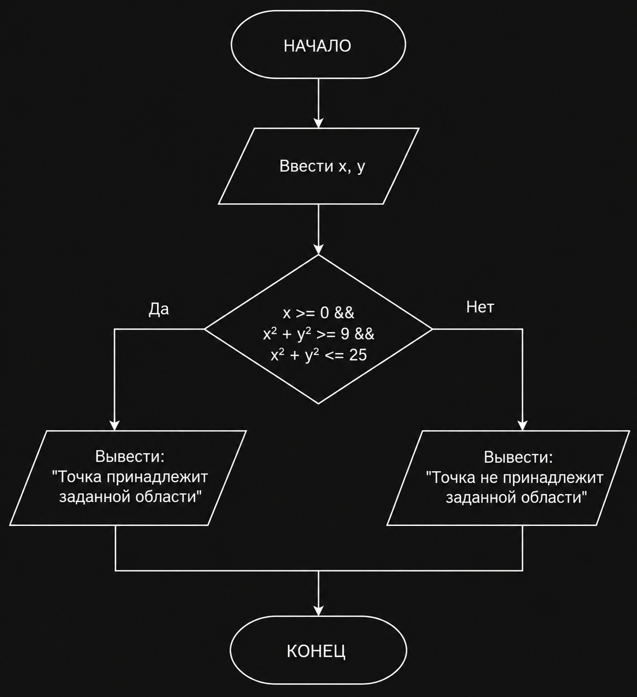

# Домашнее задание к лабораторной работе №6

## Вариант 9

### Условие задачи

Составить программу, которая проверяет, принадлежит ли заданная пользователем точка с координатами (x, y) заданной заштрихованной области, и выводит на экран соответствующее сообщение.

## Заданная область

Область представляет собой правую половину кольца с центром в начале координат.

Внутренний радиус:

R1 = 3

Внешний радиус:

R2 = 5

Для принадлежности точки области должны выполняться условия:

```text
x >= 0
9 <= x² + y² <= 25
```

На языке C:

```c
x >= 0 && x * x + y * y >= 9 && x * x + y * y <= 25
```

## Алгоритм

1. Ввести координаты точки `x` и `y`.
2. Проверить, находится ли точка в правой полуплоскости: `x >= 0`.
3. Проверить, находится ли точка вне внутренней окружности радиуса 3.
4. Проверить, находится ли точка внутри внешней окружности радиуса 5.
5. Если все условия выполняются, вывести сообщение о принадлежности точки области.
6. В противном случае вывести сообщение о том, что точка не принадлежит области.

### Блок-схема



## Код программы

```c
#include <stdio.h>

int main()
{
    double x, y;

    printf("Введите координаты x и y: ");
    scanf("%lf %lf", &x, &y);

    if (x >= 0 && x * x + y * y >= 9 && x * x + y * y <= 25)
    {
        printf("Точка принадлежит заданной области\n");
    }
    else
    {
        printf("Точка не принадлежит заданной области\n");
    }

    return 0;
}
```

## Контрольный пример

Входные данные:

```text
4 0
```

Проверка:

```text
x² + y² = 4² + 0² = 16
9 <= 16 <= 25
x >= 0
```

Все условия выполняются.

Результат:

```text
Точка принадлежит заданной области
```

Дополнительный пример:

```text
2 0
```

Получаем:

```text
x² + y² = 4
```

Так как `4 < 9`, точка не принадлежит области.

## Вывод

В ходе выполнения работы была разработана программа на языке C для проверки принадлежности точки заданной геометрической области. Для определения принадлежности использовались координаты точки, уравнения окружностей и логические операции.

## Разработчик

Каверин Максим, группа БИЦТ-262
